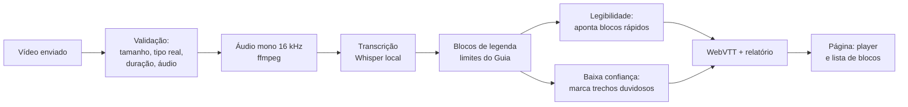

# LegendaLab

Legendas automáticas em português para pessoas surdas, que **avisam onde a IA pode ter errado** e **apontam os trechos rápidos demais para ler**.

<!-- GIF da demo: salvar em assets/demo.gif e apagar as marcas de comentário desta linha.

-->

## O problema

Legenda automática erra, e quem ouve percebe na hora. **A pessoa surda não tem como perceber**, porque não confere a legenda pelo áudio. Além disso, uma transcrição literal pode passar da velocidade de leitura recomendada.

## O que o LegendaLab faz

1. **Gera a legenda** (WebVTT) de um vídeo curto, com um modelo Whisper rodando localmente, sem API paga.
2. **Marca os trechos duvidosos**, em que o próprio modelo estava inseguro, com ⚠ e o motivo.
3. **Aponta os blocos difíceis de ler**, pelos limites do *Guia para Produções Audiovisuais Acessíveis* (2016): até 2 linhas de 37 caracteres, até 18 caracteres por segundo e de 1 a 6 segundos na tela. Aponta, mas não reescreve o texto.

E mede tudo isso com números.

## Resultados

### Qual modelo usar?

Comparei dois tamanhos do Whisper nas **427 frases do conjunto de teste do Common Voice pt-BR** (36 minutos de áudio), com 2 núcleos de CPU, imitando a máquina da demo.

| Modelo | Erro de palavra (WER) | Velocidade (RTF) |
|---|---|---|
| whisper-base | 38,6% | 0,32 |
| whisper-small | 22,9% | 0,86 |

- **WER:** palavras trocadas, faltando ou sobrando, divididas pelas palavras da frase correta, somando todas as frases.
- **RTF:** tempo de processamento ÷ duração do áudio. RTF 0,32 = 10 s de áudio transcritos em 3,2 s.
- **Regra de escolha:** o menor WER entre os modelos com RTF até 0,5. **Modelo da demo: whisper-base.**

**Conclusão:** o small erra bem menos (22,9% contra 38,6%), mas com 2 núcleos leva 0,86 s para cada segundo de áudio, acima do limite que defini para a demo responder rápido. Por isso a demo usa o base, e é justamente por ele errar mais que a marcação dos trechos duvidosos é importante.

### A marcação de "trecho duvidoso" funciona?

Apliquei às 427 frases a mesma regra que a demo usa para marcar dúvida:

- No modelo da demo (base), as frases marcadas tiveram **WER de 51,4%, contra 16,8%** nas demais, e concentraram **84% de todos os erros**.
- O custo: **60% das frases** foram marcadas, então a demo mostra muitos destaques.
- Os cortes foram definidos antes da medição (três deles são os padrões do próprio Whisper) e não foram ajustados olhando o conjunto de teste.

### Onde o modelo erra

As frases com mais erros são listas de termos técnicos e nomes próprios ("lotusscript, corelscript", "Gerdau, PagBrasil, Piccadilly"), e em duas o modelo entrou em repetição ("e o hábita e o hábita e o hábita"). As 10 piores estão em [errors.md](results/2026-10-24_145853/errors.md).

Medido em 24/10/2026 · seed 42 · normalização v1 · dados completos em [results/2026-10-24_145853](results/2026-10-24_145853/) ([resumo](results/2026-10-24_145853/summary.csv), [calibração](results/2026-10-24_145853/calibration.json)).

## Como funciona



- A IA entra **só na transcrição**. Quebra em blocos, legibilidade, marcação de dúvida e VTT são código comum, coberto por testes com pytest. Os testes usam um transcritor falso, para testar o código sem depender da IA.
- O benchmark e a demo usam **o mesmo núcleo** (`core/`), então o número da tabela descreve o que a demo faz.
- **Privacidade:** o vídeo é salvo com nome aleatório numa pasta temporária e apagado ao fim de cada pedido, inclusive quando dá erro. O log não guarda o texto transcrito nem o nome do arquivo.

## Como rodar

Pré-requisitos: Python 3.12 e ffmpeg instalados.

```
git clone https://github.com/joaopeorossi/legendalab
cd legendalab
py -3.12 -m venv .venv
.venv\Scripts\python -m pip install -r requirements.txt
.venv\Scripts\python -m uvicorn api.main:app
```

Depois, abra http://127.0.0.1:8000 (a página) ou http://127.0.0.1:8000/docs (a documentação da API). Os testes rodam com `.venv\Scripts\python -m pytest`. No Linux ou no macOS, use `python3.12 -m venv .venv` e `.venv/bin/python`.

Para refazer o benchmark, baixe o Common Voice pt-BR na Mozilla Data Collective para `data/pt-BR/` e rode:

```
.venv\Scripts\python -m bench.run_benchmark --models base small --n 427 --seed 42
.venv\Scripts\python -m bench.report results/<pasta-da-execução>
.venv\Scripts\python -m bench.calibrate results/<pasta-da-execução>
```

## Limitações

- **Fala lida em voz alta** (Common Voice), diferente da fala espontânea de um vídeo comum.
- O Whisper pode ter **ouvido esses áudios no treino**, porque o Common Voice é público. Não há como garantir que não.
- **427 frases** bastam para um projeto de estudo, mas são poucas para conclusões gerais. Muitas são listas de termos técnicos e nomes próprios, que puxam o erro para cima.
- O **RTF foi medido no meu computador**, com 2 núcleos, para imitar a máquina da demo. Na nuvem, o número pode ser outro.
- O WER **não conta pontuação** e não converte números ("3" e "três" contam como palavras diferentes).
- **Muitos destaques:** 60% das frases foram marcadas como duvidosas.
- A legenda **não descreve sons** (música, risos) **nem identifica quem fala**, como uma legenda completa para surdos faria.
- A demo aceita vídeos de até **60 s** e **30 MB**, só em português.

## Fontes

- **Limites de legibilidade:** *Guia para Produções Audiovisuais Acessíveis*, Ministério da Cultura / Secretaria do Audiovisual (MinC/SAv), 2016.
- **Dados:** Common Voice pt-BR (Mozilla, via Mozilla Data Collective), licença CC0. Os áudios não estão neste repositório, porque os termos proíbem re-hospedar; aqui ficam só as frases e os resultados.
- **Modelos:** Whisper (OpenAI), via [faster-whisper](https://github.com/SYSTRAN/faster-whisper).

## Como usei IA no desenvolvimento

Usei o Claude Code como copiloto para escrever o código. As decisões são minhas: para quem é o projeto, que métrica usar, de onde vêm os limites, a regra de escolha do modelo e o corte da marcação de dúvida. A validação dos resultados também é minha. Cada etapa terminou com testes automáticos e um registro do que aprendi no [LEARNING_LOG.md](LEARNING_LOG.md).

No produto, a IA aparece só na transcrição. Nenhuma IA reescreve, resume ou "corrige" a legenda.

<!-- Seção a escrever (João, com as próprias palavras); depois, apagar as marcas de comentário.
## Por que este projeto

-->

## Licença

[MIT](LICENSE).
